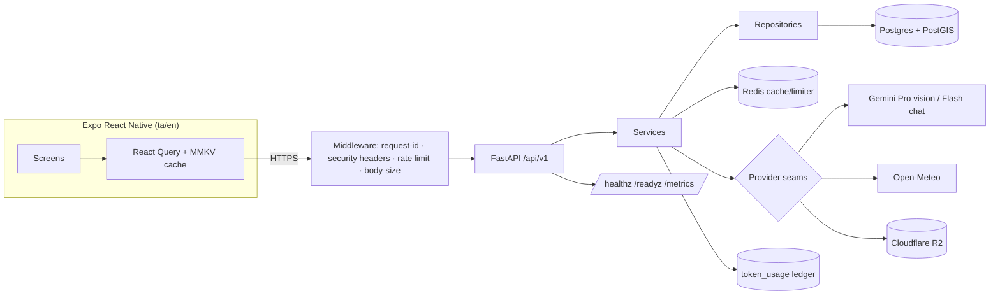

# AgrowAI

An AI agricultural assistant for small farmers in South Tamil Nadu — **Tamil-first**,
free for farmers, distributed via KVK Thoothukudi. A farmer photographs a sick
leaf and hears an honest diagnosis read aloud in Tamil, on a budget phone, on a
patchy network.

- **Backend** (`backend/`): FastAPI (Python 3.12+), PostgreSQL + PostGIS, Redis,
  Firebase auth, Alembic, ~21 modules on a router → service → repository →
  provider pattern with Protocol-based provider seams.
- **Mobile** (`agrow-ai/`): Expo React Native (SDK 57), expo-router, i18next
  (`ta`/`en`, Tamil default), Zustand, React Query, NativeWind, MMKV.

## The five product rules (enforced in code, not just docs)

1. **No commercial pesticide brands**; always warn about banned pesticides
   (single constants list).
2. **Honest uncertainty** — low confidence sets `needs_expert_review=true` and
   lowers confidence. Diagnoses, prices, and forecasts are never fabricated.
3. **Tamil-first** — every farmer-facing string exists in `ta` and `en`; Tamil
   is the default. Even backend 429/503 errors are bilingual.
4. **Farmer data ownership** — no third-party sharing, signed URLs for images,
   the deletion endpoint actually deletes.
5. **Mocks self-identify** (`provider="mock"`, `is_sample=true`) and are gated
   out of production (`ALLOW_MOCK_PROVIDERS`, boot guards).

## What's live vs. seam-only

Honesty is a feature — this table reflects reality, not aspiration.

| Capability | Status |
|-----------|--------|
| Phone/OTP auth (Firebase), farmer profile, farms | **Live** |
| AI chat — Gemini **Flash**, Pro fallback, farm-memory context | **Live** |
| Disease detection — Gemini **Pro** vision, quality gate, R2 storage | **Live** |
| Weather (Open-Meteo), market prices, crop calendar, growth | **Live** |
| Admin platform (RBAC, audit, AI cost dashboard) | **Live** |
| AI cost ledger + `/admin/ai-costs`, Redis cache, rate limiting, quotas | **Live** |
| Notifications (in-app center) | **Live** (FCM push = seam-ready) |
| SMS OTP via MSG91 | **Seam-ready** (mock default; Firebase dispatches today) |
| Satellite, soil, nutrient, schemes, experts-marketplace | **Provider seam ready, not yet live** |
| ARQ background worker, voice STT/TTS | **Planned** (see `UPGRADE_REPORT.md`) |

## Architecture



## Quickstart

**Backend**
```bash
cd backend
python -m venv .venv && . .venv/Scripts/activate   # Windows: .venv\Scripts\activate
pip install -r requirements.txt
cp .env.example .env            # fill secrets; never commit .env
alembic upgrade head
uvicorn app.main:app --reload
pytest tests -q                 # 559 tests
```

**Mobile**
```bash
cd agrow-ai
npm install
npx tsc --noEmit && npx jest    # 440 tests
npx expo start
```

## Ops & security

- Production **refuses to boot** with the dev secret, wildcard/empty CORS, or
  debug on. Docs are hidden unless `EXPOSE_DOCS=true`.
- Per-farmer daily AI quota (30 scans + 100 chats) protects the Gemini budget.
- See `backend/RUNBOOK.md` for the full env reference, rollback, and the
  "what to do when Gemini is down" playbook.

## Repo layout

```
backend/    FastAPI service, Alembic migrations, pytest suite
agrow-ai/   Expo React Native app (its own git repo), docs/, jest suite
.github/    CI (ruff · pytest+coverage · tsc · jest)
```

Engineering conventions and the authoritative spec live in `agrow-ai/docs/`
(`AGROWAI_MASTER_SPEC.md`, `PRODUCT_RULES.md`, `DATABASE_SCHEMA.md`, …).
